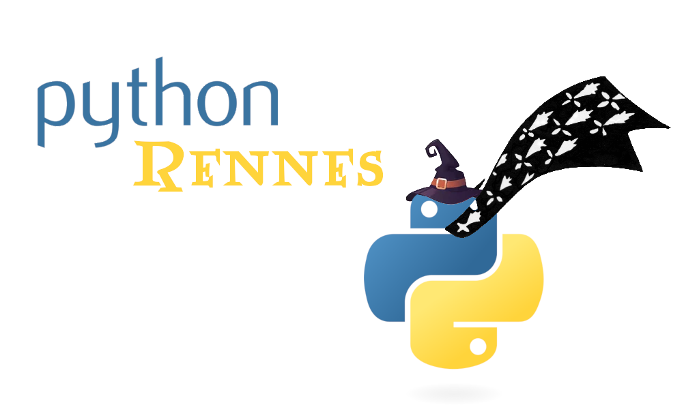
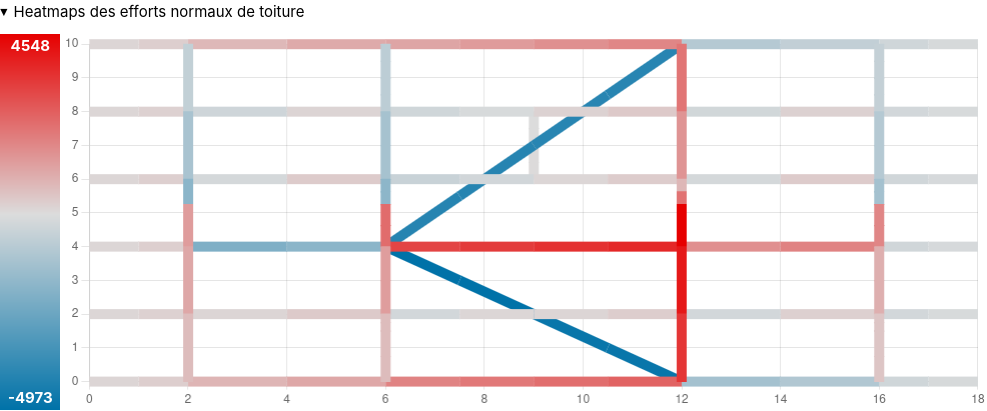

```python {.marimo hide_code="true"}
import marimo as mo
import pytest
```

# Construire une logique métier avec des opérateurs mathématiques : méthodes spéciales & métaclasses
## Datawalk : une mini-syntaxe de récupération de données

</img>
**PyConFR 2026** Biarritz - dimanche 1er novembre 2026 - Luc Sorel-Giffo

```python {.marimo hide_code="true"}
mo.mermaid(
    r"""
---
config:
  theme: base
  look: neo
---
mindmap
  id{{Luc Sorel-Giffo}}
    💻
      tech-lead / formateur chez <a href='https://www.neosoft.fr/neosoft-rennes/'>Néosoft</a>
      ex-tech-lead chez <a href='https://www.seeyousun.fr/'>SeeYouSun</a> 🌞⚡
      co-animation du meetup <a href='https://www.meetup.com/fr-FR/python-rennes/'>Python Rennes</a></img>
    🛠️ <a href='https://github.com/lucsorel/'>github.com/lucsorel</a> code-to-doc
      <a href='https://pypi.org/project/py2puml/'>pypi.org/project/py2puml</a>
      <a href='https://pypi.org/project/pydoctrace/'>pypi.org/project/pydoctrace</a>
    id)🌐(
      <a href='https://www.linkedin.com/in/lucsorel/'>www.linkedin.com/in/lucsorel</a>
      <a href='https://floss.social/@lucsorelgiffo'>@lucsorelgiffo@floss.social</a>
    """
)
```

## Au programme

Retour d'expérience sur l'élaboration d'une syntaxe de parcours de données : [github.com/lucsorel/datawalk](https://github.com/lucsorel/datawalk)

- découverte de sujets "avancés"
  - méthodes ~~magiques~~ spéciales
  - métaclasse et `@classmethod`
  - pattern matching structurel
- détourer ces notions pour vous donner des idées
- "live-coding" dans marimo

🙋🏾 questions : clarification 👍, "ça vient", "à la fin"
<!---->
## Une mini-syntaxe de récupération de données - pourquoi ?

|   |   |
|---|---|
|  |  |


Besoin : construire un rapport allant piocher des valeurs dans un dictionnaire très arborescent (~100 Mo).

1. syntaxe expressive de récupération des valeurs
2. décoreller la récupération de valeurs de la construction du rapport
3. message d'erreur informatif lors d'un échec de récupération de valeur
<!---->
## Quelques exemples de récupération classique de données

```python {.marimo}
from dataclasses import dataclass
from typing import NamedTuple

class Pet:
    def __init__(self, name: str, type: str):
        self.name = name
        self.type = type

    def __repr__(self) -> str:
        return f'Pet(name={self.name}, type={self.type})'

@dataclass
class PetDataclass:
    name: str
    type: str

class PetNamedTuple(NamedTuple):
    name: str
    type: str

data = {
    'name': 'Lucie Nation',
    'org': {
        'title': 'Datawalk',
        'address': {'country': 'France'},
        'phones': ['01 23 45 67 89', '02 13 46 58 79'],
    },
    'friends': [
        {'name': 'Frankie Manning', 'phones': []},
        {'name': 'Harry Cover', 'phones': ['02 34 56 78 91', '06 12 34 57 89']},
        {'name': 'Suzie Q', 'phone': '06 43 15 27 98'},
        {'name': 'Jean Blasin'},
    ],
    'pets': [
        {'name': 'Cinnamon', 'type': 'cat'},
        PetNamedTuple('Caramel', 'dog'),
        Pet('Melody', 'bird'),
        PetDataclass('Socks', 'cat'),
    ],
}
cinnamon, caramel, melody, socks = data['pets']
```

```python {.marimo}
# récupération du pays de l'adresse professionnelle
def test_raw_retrieve_org_country():
    assert data['org']['address']['country'] == 'France'
    assert data.get('org').get('address').get('country') == 'France'

# récupération du nom du 3e animal
def test_raw_retrieve_name_of_3rd_pet():
    assert data.get('pets')[2].name == 'Melody'

# récupérations par recherche de valeur de clé ou d'attribut
def test_raw_search_harry_2nd_phone():
    harry = next(friend for friend in data['friends'] if friend['name'] == 'Harry Cover')
    assert harry['phones'][1] == '06 12 34 57 89'

def test_raw_search_cats():
    cats = [
        pet for pet in data['pets']
        if (getattr(pet, 'type', None) == 'cat') or (isinstance(pet, dict) and pet.get('type') == 'cat')
    ]
    assert cats == [cinnamon, socks]
```

### Erreurs classiques de récupération de valeurs

Messages pas toujours très explicites (même si ils s'améliorent de version en version de Python 😊)

```python {.marimo}
# erreur d'index de liste
phone_number = data.get('friends')[0].get('phones')[1]
```

```python {.marimo}
# erreur de clé de dictionnaire
phone_number_2 = data.get('friends')[2].get('phones')[0]
```

```python {.marimo}
# erreur de nom d'attribut
data['pets'][2]._name
```

## Datawalk : le [pathlib.Path](https://docs.python.org/3/library/pathlib.html) des données ?

Expressivité de `pathlib.Path` par rapport à `os.path` :

```python
# obsolète
from os import path

user_filename = path.join(path.dirname(path.dirname(__file__)), 'schemas', 'user.json')
if path.isfile(user_filename):
    ...

# recommandé
from pathlib import Path

user_filepath = Path(__file__).parent.parent / 'schemas' / 'user.json'
if user_filepath.is_file():
    ...
```
<!---->
### 💡 Idéation

1. rendre plus lisible l'expression du chemin d'accès au données
2. décoreller la déclaration du chemin d'accès au données de leur récupération

```python
melody = data.get('pets')[2].name

melody_walk = Walk() / 'pets' / 2 / 'name'
melody = melody_walk.walk(data)
```
<!---->
Comment fonctionne l'utilisation de l'opérateur "`/`" dans `Path` ?
```python
class Path(PurePath):
    ...

class PurePath(object):
    def __truediv__(self, key):
        try:
            # ajoute le chemin donné aux précédents
            return self._make_child((key,))
        except TypeError:
            return NotImplemented
```
<!---->
Une **méthode "spéciale"** :
- a un nom en `__dunder__()`
- n'est généralement pas appelé directement
- mais appelée "sous le capot" par :
  - d'autres fonctions : `len(sequence)` appelle `sequence.__len__()`, `print(obj)`
  - des opérateurs : `obj + obj_2`, `ma_liste[::-1]`, `mon_dico['clé']`
  - des mécanismes internes :
    - itération dans une boucle **for**
    - entrée / sortie de contextmanager
<!---->
### 🧮 Méthodes spéciales "opérateurs mathématiques"

Documentation officielle :
- opérateurs mathématiques et méthodes spéciales : https://docs.python.org/3/reference/datamodel.html#emulating-numeric-types
- priorité des opérateurs : https://docs.python.org/3/reference/expressions.html#operator-precedence

Synthèse :

|  Priorité | Opérateur | Méthode spéciale |
|---|---|---|
| 1 | ** | `__pow__(self, other[, modulo])` |
| **2** | /  | `__truediv__(self, other)` |
| **2** | // | `__floordiv__(self, other)` |
| **2** | @ | `__matmul__(self, other)` |
| **2** | % | `__mod__(self, other)` |
| **2** | * | `__mul__(self, other)` |
| 3 | + | `__add__(self, other)` |
| 3 | - | `__sub__(self, other)` |
| 4 | << | `__lshift__(self, other)` |
| 4 | >> | `__rshift__(self, other)` |
| 5 | & | `__and__(self, other)` |
| 6 | ^ | `__xor__(self, other)` |
| **7** | `|` | `__or__(self, other)` |
<!---->
### Choix de conception pour `datawalk`

- utiliser des opérateurs de même priorité pour exprimer un chemin de donnée sans devoir recourir à des parenthèses (lisibilité)

-> **priorité 2** (`/`, `//`, `@`, `%`, `*`) : pour avoir le plus de possibilités sémantiques

- utiliser un opérateur moins prioritaire pour appliquer la recherche de valeurs sur une structure de données

-> **priorité 7** : `|`, familiarité avec son utilisation dans les shells unix pour "piper" des données

```python
value = my_walk.walk(data)
value = my_walk | data
```
<!---->
## 🧪 TP : squelette de `datawalk.Walk`

```python {.marimo}
from typing import Any, Iterable, Hashable, Protocol

class WalkError(LookupError):
    def __init__(self, /, message, *, data_state=None):
        super().__init__(message)
        self.data_state = data_state

class Selector(Protocol):
    def __call__(self, state: Any) -> Any: ... # sélectionne une valeur dans la structure de données
    def __repr__(self) -> str: ... # affiche le comportement du sélecteur

class Walk:
    def __init__(self, *selectors: Selector):
        self.selectors = tuple(selectors)

    def walk(self, data) -> Any:
        current_state = data
        passed_selectors = []
        for selector in self.selectors:
            try:
                current_state = selector(current_state)
                passed_selectors.append(selector)
            except Exception as error:
                raise WalkError(
                    f'walked ({" ".join(str(selector) for selector in passed_selectors)}) of ({self}) but could not find {selector} in the current data state',
                    data_state=current_state,
                ) from error

        return current_state
```

### 👣 Support du "/" pour les chemins de données

```python
walk = Walk() / 'key'
```

```python {.marimo}
data
```

```python {.marimo}
# implémentation du chemin des données
def test_walk_no_selector():
    assert Walk().walk(data) == data

def test_walk_dict_key_selector():
    assert (Walk() / 'name').walk(data) == 'Lucie Nation'

def test_walk_list_index_selector():
    assert (Walk() / 'friends' / 0 / 'name').walk(data) == 'Frankie Manning'

def test_walk_object_attr_selector():
    assert (Walk() / 2 / 'type').walk(data['pets']) == 'bird'
```

```python
class Walk:
    # ...
    def __truediv__(self, step: Hashable) -> 'Walk':
        '''
        >>> walk / 'key'
        '''
        return Walk(*self.selectors, ByKey(step))

class ByKey:
    def __init__(self, key):
        self.key = key

    def __call__(self, state) -> Any:
        # récupération par une clé pour une séquence ou un dictionnaire
        if isinstance(self.key, int) or isinstance(state, dict):
            return state[self.key]
        # récupération par une propriété sinon
        else:
            return getattr(state, self.key)

    def __repr__(self) -> str:
        if isinstance(self.key, int):
            return f'[{self.key}]'
        else:
            return f'.{self.key}'
```
<!---->
### 🚶‍♀️‍➡️ Support de l'opérateur "|" pour rechercher une valeur avec le chemin

```python
value = walk.walk(data)
value = walk | data
```

```python {.marimo}
# implémentation de l'opérateur "|" pour .walk(...)
def test_walk_no_selector_with_pipe():
    assert Walk() | data == data

def test_walk_dict_key_selector_with_pipe():
    assert Walk() / 'name' | data == 'Lucie Nation'

def test_walk_list_index_selector_with_pipe():
    assert Walk() / 'friends' / 0 / 'name' | data == 'Frankie Manning'

def test_walk_object_attr_selector_with_pipe():
    assert Walk() / 2 / 'type' | data['pets'] == 'bird'
```

```python
class Walk:
    # ...
   def __or__(self, data) -> Any:
       '''
       >>> walk | data
       '''
       return self.walk(data)
```
<!---->
### 🔍 Support de l'opérateur "@" pour sélectionner une entrée dans une liste

```python
# la 1re entrée dont la propriété `key` vaut `value`
walk = Walk() @ (key, value)
```

```python {.marimo}
def test_walk_select_first_by_key_value_friend():
    assert Walk() / 'friends' @ ('name', 'Suzie Q') / 'phone' | data == '06 43 15 27 98'

def test_walk_select_first_by_key_value_pet():
    assert Walk() / 'pets' @ ('type', 'bird') / 'name' | data == 'Melody'
```

```python
class Walk:
    # ...
    def __matmul__(self, filter: tuple[Hashable, Hashable]) -> Any:
        '''
        >>> walk @ (key, value)
        '''
        match filter:
            case [key, value]:
                return Walk(*self.selectors, First(key, value))
            case _:
                raise ValueError(f'unsupported filter: {filter}')

_DEFAULT = object()
def value_getter(item: dict | object, key: Hashable):
    if isinstance(item, dict):
        return item.get(key, _DEFAULT)
    else:
        return getattr(item, key, _DEFAULT)

class First:
    def __init__(self, key, value):
        self.key = key
        self.value = value

    def __call__(self, state: list | tuple) -> Any:
        return next(item for item in state if value_getter(item, self.key) == self.value)

    def __repr__(self) -> str:
        return f'@({self.key}=={self.value})'
```
<!---->
### 🪮 Support de l'opérateur "%" pour sélectionner des entrées dans une séquence

```python
# toutes les entrées dont la propriété `key` est dans la liste `values`
walk = Walk() % (key, [*values])
```

```python {.marimo}
def test_walk_select_all_by_key_in_values_pets():
    assert Walk() / 'pets' % ('name', ['Caramel', 'Socks']) | data == [caramel, socks]
```

```python
class Walk:
    # ...
    def __mod__(self, filter: tuple[Hashable, Iterable]):
        '''
        >>> walk % (key, [values])
        '''
        match filter:
            case [key, [*values]]:
                return Walk(*self.selectors, All(key, values))

            case [key, value]:
                raise ValueError(f'unsupported filter: {filter}, value {value} must be a sequence')

            case _:
                raise ValueError(f'unsupported filter: {filter}')

class All:
    def __init__(self, key: Hashable, values: Iterable):
        self.key = key
        self.values = values

    def __call__(self, state: Iterable[dict | object]) -> list:
        return [item for item in state if value_getter(item, self.key) in self.values]

    def __repr__(self) -> str:
        return f'%({self.key} in {self.values})'


```
<!---->
### 📜 Représentation du chemin de données

```python
walk = Walk() / 'pets' / 2 / 'type'
print(walk) # '.pets [2] .type'
```

```python {.marimo}
def test_walk_representation_by_keys():
    assert repr(Walk() / 'pets' / 2 / 'name') == '.pets [2] .name'
    assert str(Walk() / 'pets' / 2 / 'type') == '.pets [2] .type'

def test_walk_representation_first():
    assert f"{Walk() / 'pets' @ ('type', 'bird') / 'name'}" == '.pets @(type==bird) .name'

def test_walk_representation_all():
    assert f"{Walk() / 'pets' % ('type', ['bird', 'dog'])}" == ".pets %(type in ['bird', 'dog'])"
```

```python {.marimo}
# messages d'erreur explicites
def test_walk_mismatching_steps_empty_list():
    with pytest.raises(WalkError) as error:
        phone_number = Walk() / 'friends' / 0 / 'phones' / 1 | data

    walk_error = error.value
    assert str(walk_error) == (
        'walked (.friends [0] .phones) of (.friends [0] .phones [1]) but could not find [1] in the current data state'
    )
    assert walk_error.data_state == []

def test_walk_mismatching_steps_dict_without_key():
    with pytest.raises(WalkError) as error:
        phone_number = Walk() / 'friends' / 2 / 'phones' / 0 | data

    walk_error = error.value
    assert str(walk_error) == (
        'walked (.friends [2]) of (.friends [2] .phones [0]) but could not find .phones in the current data state'
    )
    assert walk_error.data_state == {"name": "Suzie Q", "phone": "06 43 15 27 98"}

def test_walk_mismatching_steps_instance_without_attr():
    with pytest.raises(WalkError) as error:
        pet_weight = Walk() / 'pets' / 2 / 'weight' | data

    walk_error = error.value
    assert str(walk_error) == (
        'walked (.pets [2]) of (.pets [2] .weight) but could not find .weight in the current data state'
    )
    assert str(walk_error.data_state) == 'Pet(name=Melody, type=bird)'
```

```python
class Walk:
    def __repr__(self) -> str:
        return ' '.join(f'{selector}' for selector in self.selectors)
```
<!---->
## C'est dommage de commencer les chemins par une instance vide : `Walk()` 🙁

Comment passer de :

```python
walk = Walk() / 'key'
walk = Walk() @ (key, value)
walk = Walk() % (key, [values])
```
à
```python
walk = Walk / 'key'
walk = Walk @ (key, value)
walk = Walk % (key, [values])
```
?

```python {.marimo}
def test_class_walk_by_keys():
    assert Walk / 'pets' / 2 / 'name' | data == 'Melody'

def test_class_walk_filter_first():
    assert Walk / 'pets' @ ('type', 'cat') / 'name' | data == 'Cinnamon'

def test_class_walk_filter_all():
    assert Walk / 'pets' % ('type', ['bird', 'dog']) | data == [caramel, melody]
```

### Ajouter une méthode de classe ?

```python
class Walk():
    def __init__(self, *selectors: Selector):
        self.selectors = tuple(selectors)

    def __truediv__(self, step: Hashable) -> 'Walk':
        return Walk(*self.selectors, ByKey(step))

    @classmethod
    def __truediv__(cls, step: Hashable) -> 'Walk':
        return Walk() / step
```

Les cas précédents ne fonctionnent plus 😬

```python
Walk() / 'name' | data
# RecursionError: maximum recursion depth exceeded
```

La méthode de classe n'est pas appelée 😢

```python
Walk / 'name' | data
# TypeError: unsupported operand type(s) for /: 'type' and 'str'
```

D'où vient ce "`type`" dans "_unsupported / operand between 'type' and 'str'_" ? 🤔
<!---->
```python
a_walk = Walk()

type(a_walk)              # <class '__main__.Walk'>
a_walk.__class__          # <class '__main__.Walk'>

type(type(a_walk) )       # <class 'type'> type est la métaclasse de Walk

type(type(type(a_walk) )) # <class 'type'> type est la métaclasse de type
```

```python {.marimo hide_code="true"}
mo.mermaid(
    r"""
    flowchart LR
        a_walk -->|est une instance de| Walk
        Walk -->|est une instance de| type[type]
        type[type] -->|est une instance de| type[type]

    """
)
```

### Les métaclasses

Article détaillé : https://realpython.com/python-metaclasses/

> Metaclasses are deeper magic than 99% of users should ever worry about.
> If you wonder whether you need them, you don’t (the people who actually need them know with certainty that they need them, and don’t need an explanation about why).

— Tim Peters (auteur du "zen of Python" - `import this` pour l'afficher)

💡 : une classe est une instance de sa métaclasse.
<!---->
```python
class MetaWalk(type):
    '''
    Hériter de type fait de MetaWalk une métaclasse
    '''
    def __truediv__(cls, step: Hashable) -> 'Walk':
        '''
        >>> Walk / 'key'
        '''
        return Walk(ByKey(step))

    def __matmul__(cls, filter: tuple[Hashable, Hashable]) -> Any:
        '''
        >>> Walk @ ('key', 'value')
        '''
        return Walk() @ filter

    def __mod__(cls, filter: tuple[Hashable, Iterable]):
        '''
        >>> Walk % ('key', [*values])
        '''
        return Walk() % filter

class Walk(metaclass=MetaWalk):
    ...
```

```python {.marimo}
a_walk = Walk()

print(type(a_walk))
print(type(type(a_walk)))
print(type(type(type(a_walk))))
print(type(type(type(type(a_walk)))))
```

```python {.marimo hide_code="true"}
mo.mermaid(
    r"""
    flowchart LR
        a_walk -->|instance de| Walk
        Walk -->|instance de| MetaWalk
        MetaWalk -->|instance de| type[type]
        type[type] -->|instance de| type[type]

    """
)
```

## Version de `ByKey.__call__()` avec du pattern matching structurel ?

```python
class ByKey:
    # ...
    def __call__(self, state) -> Any:
        # récupération par une clé pour une séquence ou un dictionnaire
        if isinstance(self.key, int) or isinstance(state, dict):
            return state[self.key]
        # récupération par une propriété sinon
        else:
            return getattr(state, self.key)
```

Documentation sur le pattern matching :
- PEP 636 qui en présente le formalisme et utilisations : https://peps.python.org/pep-0636/
- un tutoriel approfondi : https://realpython.com/structural-pattern-matching/
<!---->
```python
class ByKey:
    # ...
    def __call__(self, state) -> Any:
        match self.key, state:
            # clé de séquence ordonnée
            case int(), _:
                return state[self.key]
            # clé de dictionnaire
            case _, {self.key: value}:
                return value
            # attribut de classe
            case _, _:
                return getattr(state, self.key)
```
<!---->
## Conclusion

Ça va, la tête 😬 ?
<!---->
### Bilan

- 🧰 les méthodes spéciales permettent d'ajouter du comportement à des instances, déclenché par les opérateurs
- ⚠️ attention aux priorités des opérateurs
- **pattern matching structurel** : pour remplacer des conditions portant sur la structure des données
- une classe est une **instance** de sa **métaclasse** (`type` par défaut)
- `@classmethod` "émule" une méthode de classe
  - n'ajoute pas une méthode de classe
  - décorateur qui passe la classe de l'instance (`self.__class__`) à la méthode décorée plutôt que "`self`"
- 🥴 pas d'autocomplétion par l'IDE sur les opérateurs mathématiques et les méthodes spéciales sous-jacentes
- 🥴 incohérence : _nom de méthode spéciale_ `!=` _rôle métier surchargé_ (-> alias de méthodes)
<!---->
### Merci pour votre attention 🙏

🙋🏾Des questions ?

Pour me faire vos retours (sur [openfeedback.io](https://openfeedback.io/pyconfr-2026-lucsorel-giffo/2026-11-01/MYxNUYIB2b0deaH2gmaA)) :

</img>

Utiliser `datawalk` dans votre projet ? [pypi.org/project/datawalk](https://pypi.org/project/datawalk/)

Diaporama & notebook : [github.com/lucsorel/conferences/tree/main/pyconfr-2026.11.01-dsl_données_avec_opérateurs](https://github.com/lucsorel/conferences/tree/main/pyconfr-2026.11.01-dsl_donn%C3%A9es_avec_op%C3%A9rateurs)
<!---->
## Bonus
<!---->
### Alias de méthodes

Suite à ma conclusion de _dissonance cognitive_ "ça fait bizarre d'implémenter des méthodes spéciales dont le nom ne re reflètent pas ce qu'elle fait", il m'a été suggéré l'approche suivante (faire des alias de méthodes) qui a 2 intérêts :

1. implémenter le comportement dans une méthode dont le nom reflète ce qu'elle fait
2. proposer le comportement par une API en plus de l'opérateur

```python
    class Walk(metaclass=MetaWalk):
        ...
        def filter_first(self, filter: tuple[Hashable, Hashable]) -> Any:
            '''
            Définition de l'API de la classe avec une méthode au nom porteur de sens
            >>> walk.filter_first(key, value)
            '''
            match filter:
                case [key, value]:
                    return Walk(*self.selectors, First(key, value))
                case _:
                    raise ValueError(f'unsupported filter: {filter}')

        # support de l'opérateur @ : walk @ (key, value)
        __matmul__ = filter_first
```

Avec cette modification, les tests automatisés suivants passent bien :

```python
def test_walk_filter_first_with_api_method():
    friends_walk = Walk() / 'friends'
    assert friends_walk.filter_first(('name', 'Suzie Q')) / 'phone' | data == '06 43 15 27 98'

def test_walk_filter_first_operator():
    assert Walk() / 'friends' @ ('name', 'Suzie Q') / 'phone' | data == '06 43 15 27 98'
```
<!---->
### 💙💛 squelette complet de `datawalk.Walk`
<!---->
```python
from typing import Any, Iterable, Hashable, Protocol

class WalkError(LookupError):
    def __init__(self, /, message, *, data_state=None):
        super().__init__(message)
        self.data_state = data_state

class Selector(Protocol):
    def __call__(self, state: Any) -> Any: ... # sélectionne une valeur dans la structure de données
    def __repr__(self) -> str: ... # affiche le comportement du sélecteur

class MetaWalk(type):
    '''
    Hériter de type fait de MetaWalk une metaclass
    '''
    def __truediv__(cls, step: Hashable) -> 'Walk':
        return Walk(ByKey(step))

    def __matmul__(cls, filter: tuple[Hashable, Hashable]) -> Any:
        return Walk() @ filter

    def __mod__(cls, filter: tuple[Hashable, Iterable]):
        return Walk() % filter

class Walk(metaclass=MetaWalk):
    def __init__(self, *selectors: Selector):
        self.selectors = tuple(selectors)

    def __truediv__(self, step: Hashable) -> 'Walk':
        return Walk(*self.selectors, ByKey(step))

    def walk(self, data) -> Any:
        current_state = data
        passed_selectors = []
        for selector in self.selectors:
            try:
                current_state = selector(current_state)
                passed_selectors.append(selector)
            except Exception as error:
                raise WalkError(
                    f'walked ({" ".join(str(selector) for selector in passed_selectors)}) of ({self}) but could not find {selector} in the current data state',
                    data_state=current_state,
                ) from error

        return current_state

    def __or__(self, data) -> Any:
        return self.walk(data)

    def __repr__(self) -> str:
        return ' '.join(f'{selector}' for selector in self.selectors)

    def __matmul__(self, filter: tuple[Hashable, Hashable]) -> Any:
        '''
        >>> walk @ (key, value)
        '''
        match filter:
            case [key, value]:
                return Walk(*self.selectors, First(key, value))
            case _:
                raise ValueError(f'unsupported filter: {filter}')

    def __mod__(self, filter: tuple[Hashable, Iterable]):
        '''
        >>> walk % (key, [values])
        '''
        match filter:
            case [key, [*values]]:
                return Walk(*self.selectors, All(key, values))

            case [key, value]:
                raise ValueError(f'unsupported filter: {filter}, value {value} must be a sequence')

            case _:
                raise ValueError(f'unsupported filter: {filter}')

class All:
    def __init__(self, key: Hashable, values: Iterable):
        self.key = key
        self.values = values

    def __call__(self, state: Iterable[dict | object]) -> list:
        return [item for item in state if value_getter(item, self.key) in self.values]

    def __repr__(self) -> str:
        return f'%({self.key} in {self.values})'

_DEFAULT = object()
def value_getter(item: dict | object, key: Hashable):
    if isinstance(item, dict):
        return item.get(key, _DEFAULT)
    else:
        return getattr(item, key, _DEFAULT)

class First:
    def __init__(self, key, value):
        self.key = key
        self.value = value

    def __call__(self, state: list | tuple) -> Any:
        return next(item for item in state if value_getter(item, self.key) == self.value)

    def __repr__(self) -> str:
        return f'@({self.key}=={self.value})'

class ByKey:
    def __init__(self, key):
        self.key = key

    def __call__(self, state) -> Any:
        match self.key, state:
            # clé de séquence ordonnée
            case int(), _:
                return state[self.key]
            # clé de dictionnaire
            case _, {self.key: value}:
                return value
            # attribut de classe
            case _, _:
                return getattr(state, self.key)

    def __repr__(self) -> str:
        if isinstance(self.key, int):
            return f'[{self.key}]'
        else:
            return f'.{self.key}'
```